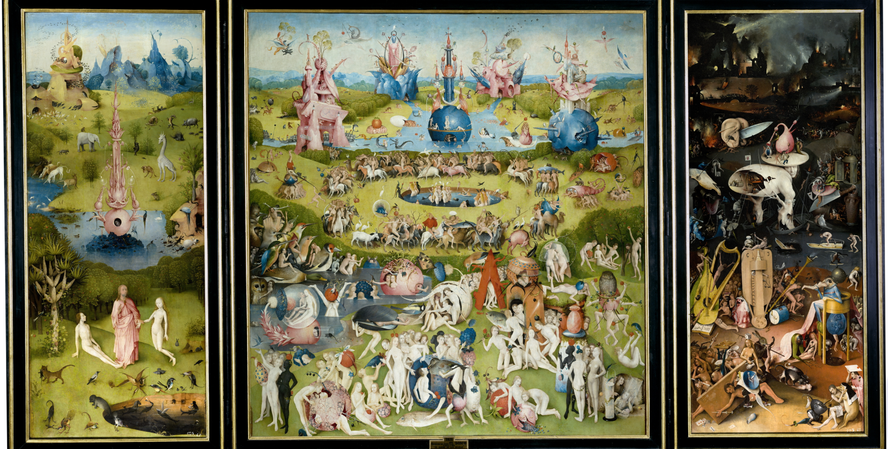

  

<h1 align="center">Дмитрий Сизов</h1>

  <code>@dimoshek</code> &nbsp;/&nbsp; дизайнер &nbsp;/&nbsp; основатель MARTHELL

 

## Обо мне

Я учусь в колледже и развиваю свою дизайн-студию MARTHELL. Делаю брендинг, сайты и материалы для соцсетей. Параллельно учу C, Python и HTML/CSS и решаю олимпиадные задачи, чтобы лучше понимать, как устроены продукты, которые я проектирую.

Вне кода занимаюсь фотографией, короткими видео и AI-визуалом.

 

## Проекты

<table>
  <tr>
    <td width="50%">
      <a href="https://github.com/dimoshek/c_olymp"><b>c_olymp</b></a> 
      Олимпиадные задачи: Codeforces, Timus, Яндекс, Абрамян. Язык: C.
    </td>
    <td width="50%">
      <b>MARTHELL</b> 
      Дизайн-студия. Сайт в планах.
    </td>
  </tr>
</table>

 

## Инструменты

  

 

## Цифры

  
  

 

## Связь

